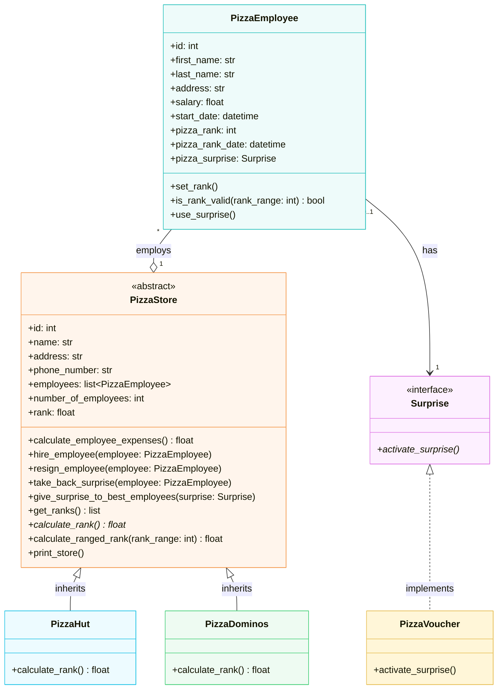

# Pizza Management System - Exam II Practice

Employee management for two pizza stores: **Pizza Hut** and **Pizza Dominos**.

1. Class diagram (below)
2. Python implementation: `pizza.py`
3. Submitted as this Git repository

## Class Diagram



- Pizza Hut rank = **average** of the employees' ranks, Pizza Dominos rank = **sum**.
- `FreeDessert` (in the tests) isn't a `Surprise` subclass but has `activate_surprise()` - duck typing.

## Run

```bash
python pizza.py
```

Needs the `overrides` package (`pip install overrides`).
