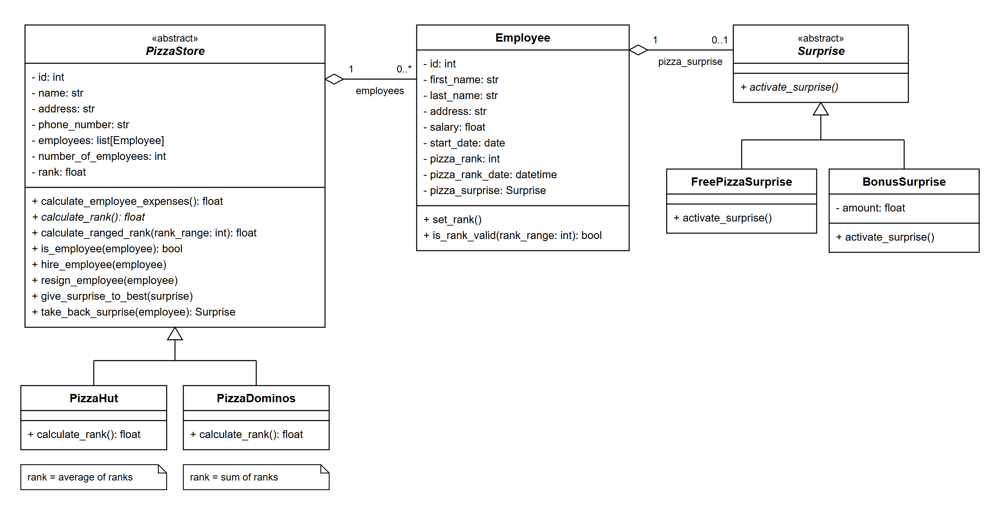

# Class Diagram

- `PizzaStore` is abstract. `PizzaHut` and `PizzaDominos` each implement `calculate_rank()`:
  Pizza Hut uses the average of the employee ranks, Pizza Dominos uses the sum.
- A store has 0..* employees. An employee has 0..1 surprise.
- `Surprise` is abstract, so every surprise type must implement `activate_surprise()`.
