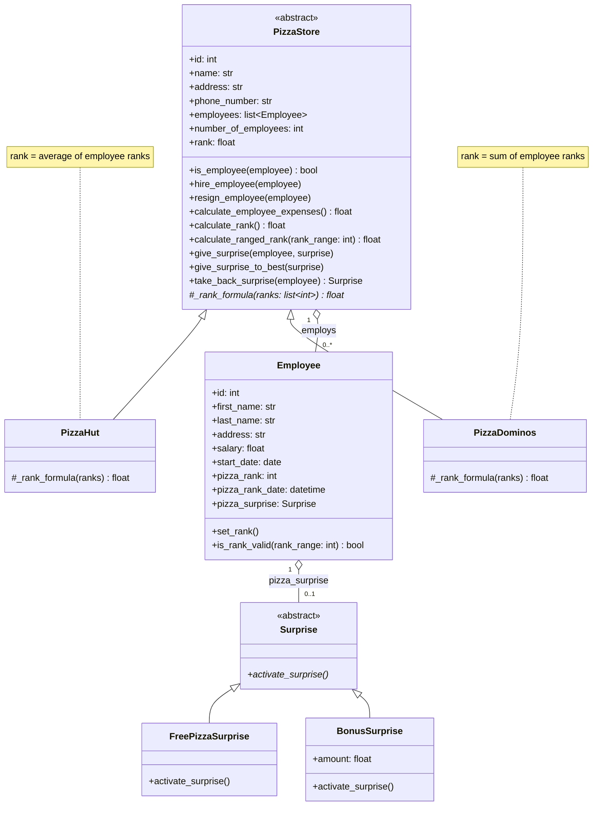

# Pizza Management System - Class Diagram

## Design notes

- **PizzaStore** is abstract. The only thing that differs between the two stores is how the
  rank is calculated, so each subclass implements `_rank_formula()` (Template Method):
  `PizzaHut` = average of employee ranks, `PizzaDominos` = sum of employee ranks.
- The constructor calls `calculate_rank()`, so every new store starts with a rank.
- `number_of_employees` is a property computed from the employees list, so it can never go out of sync.
- `hire_employee()` / `resign_employee()` check `is_employee()` before changing the list.
  Resigning also takes back the employee's surprise.
- `calculate_ranged_rank(rank_range)` asks every employee whose rank is older than
  `rank_range` days to rank again (`set_rank()`), then recalculates the store rank.
- **Surprise** is an abstract class with `activate_surprise()`, so any surprise type works
  as long as it implements that method. An employee's surprise may be `None`.
